# Sefer Entry Prep: User Manual

| | |
|---|---|
| **Product** | Sefer Entry Prep (web application) |
| **Website** | https://sefer-webapp.vercel.app |
| **Version** | October 2026 |
| **Audience** | Licensed customs brokers and the operations staff who prepare entries for them |

---

## Contents

1. [About this manual](#1-about-this-manual)
2. [Product overview](#2-product-overview)
3. [Getting started](#3-getting-started)
4. [A tour of the screen](#4-a-tour-of-the-screen)
5. [Step-by-step tasks](#5-step-by-step-tasks)
6. [Reference](#6-reference)
7. [Troubleshooting](#7-troubleshooting)
8. [Frequently asked questions](#8-frequently-asked-questions)
9. [Glossary](#9-glossary)
10. [Limits and further reading](#10-limits-and-further-reading)

---

## 1. About this manual

This manual shows how to turn a shipment's documents into a NetCHB entry file with the Sefer Entry Prep website. It covers every screen, each task step by step, and what to do when something goes wrong.

**Conventions**

- **Bold text** is a label or button on screen, for example **Use sample shipment**.
- The numbered blue badges in each screenshot match the numbered steps beside it.
- ⚠️ marks something that affects what is filed with U.S. Customs.

---

## 2. Product overview

### What it does

You upload a shipment's documents: the commercial invoice, the packing list, and the bill of lading or air waybill, as PDFs or photos. The website:

1. **Reads the documents.** An AI model transcribes what each page says, including errors, crossed-out values and footnotes.
2. **Checks them against each other.** Rules written in code recompute every number, compare the documents line by line, and apply customs valuation (for example, removing freight from a CIF price or adding a buyer-supplied material as an assist).
3. **Lists its findings.** Every discrepancy, every value it changed (with the before and after values and the reason), and every field no document can supply.
4. **Produces the NetCHB entry file.** It builds a Type 01 consumption entry in NetCHB's XML format and checks it against NetCHB's published schema.

### What it does not do

- ⚠️ **It never files anything.** The XML has no transmit instruction, so uploading it to NetCHB only stages the entry. A licensed broker reviews it in NetCHB and transmits it from there.
- **It does not classify goods to 10-digit HTS numbers.** Invoices usually give 6 digits; the broker enters the full number.
- **It does not calculate duty.** NetCHB does that from the tariff numbers.
- **It never silently picks between conflicting values.** When two readings disagree, it shows both and asks you.

---

## 3. Getting started

### What you need

| Item | Details |
|---|---|
| A web browser | A current desktop browser; tested in Chrome and Microsoft Edge. Phones are supported for review. |
| Documents | PDF, PNG, JPG or WEBP. Scans and phone photos are fine. |
| File size | Up to **4.4 MB per file** on the website. |
| An access code | Only if your administrator has switched one on. The sample shipment never needs one. |

### Quick start (5 minutes)

1. Open **https://sefer-webapp.vercel.app**.
2. Click **Use sample shipment** to load a real example, or choose your own files and click **Extract**.
3. Work through the **Findings**, starting with the red errors.
4. Fill in the **Broker inputs** and the 10-digit **HTS** numbers.
5. When the XML panel shows **Valid against NetCHB entry.xsd**, click **Download**.

---

## 4. A tour of the screen

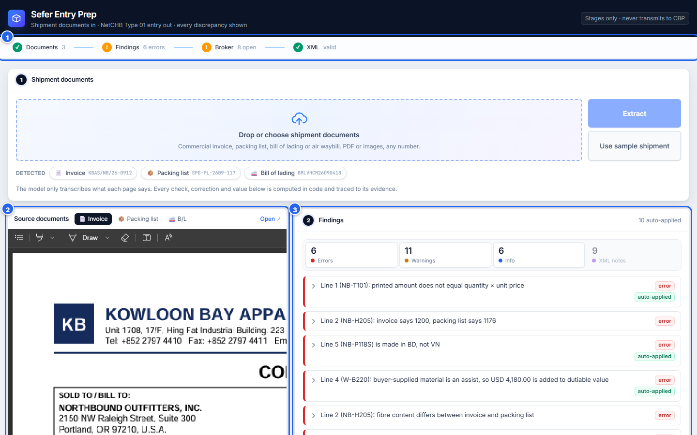

1. **Progress bar.** It shows where you are: **Documents → Findings → Broker → XML**. A green ✓ means done; an amber **!** means something needs your attention. Click any step to jump to it. It stays at the top of the screen as you scroll.
2. **Source documents.** The original document, always beside your work, so you can check any value against the page.
3. **The review area**, in numbered sections:

| Section | What it is for |
|---|---|
| ① **Shipment documents** | Upload files or load the sample. |
| ② **Findings** | Every discrepancy, correction and open question, with evidence. |
| ③ **Broker inputs** | Information only the broker has (importer number, bond, entry date…). |
| ④ **Entry lines** | Each line as it will be entered: value, origin, manufacturer ID, HTS. |
| ⑤ **NetCHB entry XML** | The file for NetCHB, its validation result, copy and download. |
| ⑥ **Compliance audit trail** | A record of how the entry was prepared, for your files. |
| **Extracted documents** | Exactly what was read from each page, editable. |

Every change you make anywhere is applied within about a second. The findings and XML rebuild automatically; nothing is sent to the AI model again.

---

## 5. Step-by-step tasks

### 5.1 Load your documents

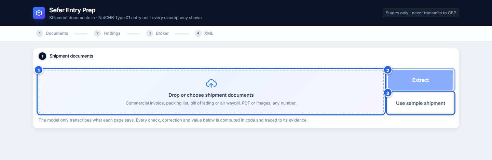

1. Click the **drop zone** and choose your files. Select all of a shipment's documents at once, in any order. A single PDF that contains several documents also works.
2. Click **Extract**. Each file is read separately; with several files the button shows **Reading 2 of 3…**. Scans can take from a few seconds to a couple of minutes.
3. Or click **Use sample shipment** to load a real example instantly.

When reading finishes, chips under the drop zone confirm what was recognised, for example 📄 **Invoice**, 📦 **Packing list**, 🚢 **Bill of lading**, each with its document number.

> **Tip.** If a document type is missing from the chips, the file may not have been readable. Check the messages under the drop zone (see [Troubleshooting](#7-troubleshooting)).

### 5.2 Check the source documents side by side

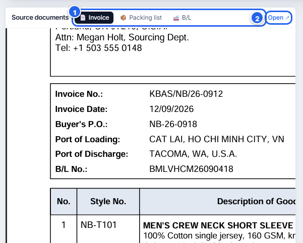

1. Use the **tabs** to switch between the invoice, packing list and bill of lading.
2. Click **Open ↗** to open the document full size in a new browser tab.

You can also jump straight to the right document from a finding (step 5.3) or from **Extracted documents** (step 5.6).

### 5.3 Work through the findings

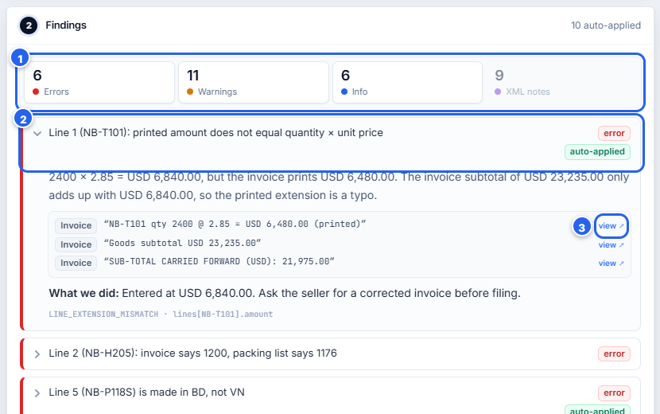

1. **Filter by severity.** The four counters show **Errors**, **Warnings**, **Info** and **XML notes**. Click a counter to show or hide that group. XML notes are hidden at first.
2. **Open a finding** by clicking its title. You will see:
   - what was found and why it matters;
   - the **evidence**: short quotes from the documents, each labelled with its source;
   - **What we did** (if the website changed a value) or **Action** (if you need to act).
   - The green **auto-applied** badge means the website changed a value on the entry. The finding always shows both values and the reason.
3. Click **view ↗** next to any quote to open that document in the viewer and check it yourself.

**Recommended order:** errors first, then warnings, then info.

### 5.4 Complete the broker inputs

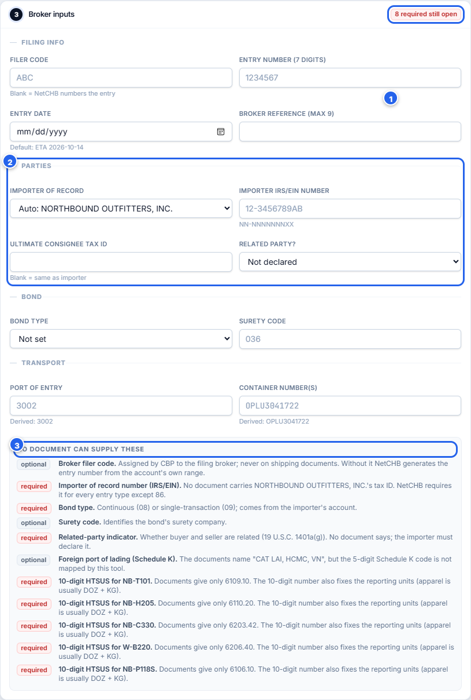

1. The badge in the corner counts **required** items still open. It turns green (**✓ complete**) when everything required is filled in.
2. Fill in the four groups:
   - **Filing info:** filer code and entry number (leave blank to let NetCHB number the entry), entry date, your reference.
   - **Parties:** importer of record (the website proposes one and explains why in the findings; change it here if needed), importer IRS/EIN number, ultimate consignee tax ID, related-party declaration.
   - **Bond:** continuous (08) or single transaction (09), and surety code.
   - **Transport:** port of entry (pre-filled when it can be derived) and container numbers (to override what was read).
3. **No document can supply these** lists every remaining gap, marked **required** or **optional**, with the reason.

### 5.5 Review the entry lines and enter HTS numbers

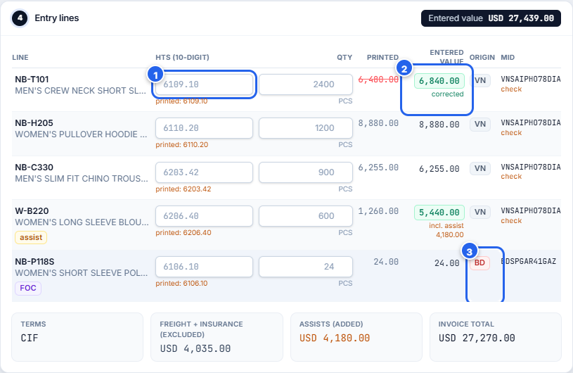

1. Type the **10-digit HTS number** for each line. The number printed on the invoice is shown underneath for reference. The website never pads a 6-digit code with zeros, because that would look like a real classification.
2. Compare **Printed** with **Entered value**. A green highlight means the entered value differs from the printed one: a corrected arithmetic error (**corrected**), or an added assist (**incl. assist**). Free-of-charge lines carry a purple **FOC** badge and are still entered at their stated value.
3. Check **Origin** and **MID** (manufacturer ID). A red origin badge means the line's own remarks give a different country from the rest of the shipment. **check** under a MID means it was built from an address CBP's rules don't settle cleanly; confirm it against your NetCHB manufacturer records.

You can also override a line's quantity in the **Qty** field.

### 5.6 Correct a misread value

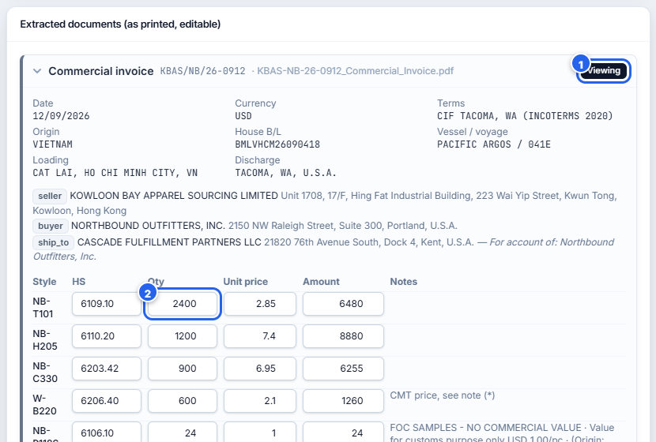

1. Under **Extracted documents**, open a document and click **View source** to show it in the viewer.
2. Compare the values, and correct any misread **HS**, **Qty**, **Unit price** or **Amount** directly in the table.

The findings, values and XML update immediately. ⚠️ Edit only values that were *read* wrongly. If the document itself is wrong (for example, a typo on the invoice), leave it: the findings will flag it and the audit trail will record it.

### 5.7 Resolve XML validation issues

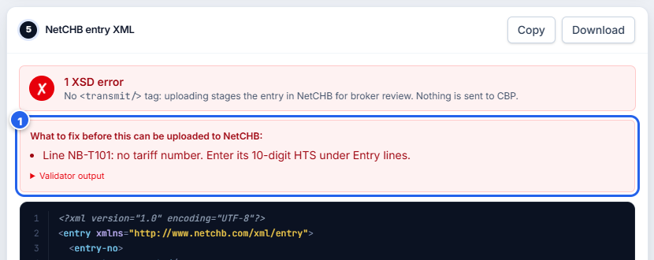

When the XML does not yet meet NetCHB's schema, the panel shows a red **✗** and a list headed **What to fix before this can be uploaded to NetCHB**.

1. Each item says what is missing and where to fix it, for example *"Line NB-T101: no tariff number. Enter its 10-digit HTS under Entry lines."* Fix the items one by one; the list shrinks as you go.

Click **Validator output** to see the schema validator's original messages, if you need them.

### 5.8 Copy or download the NetCHB XML

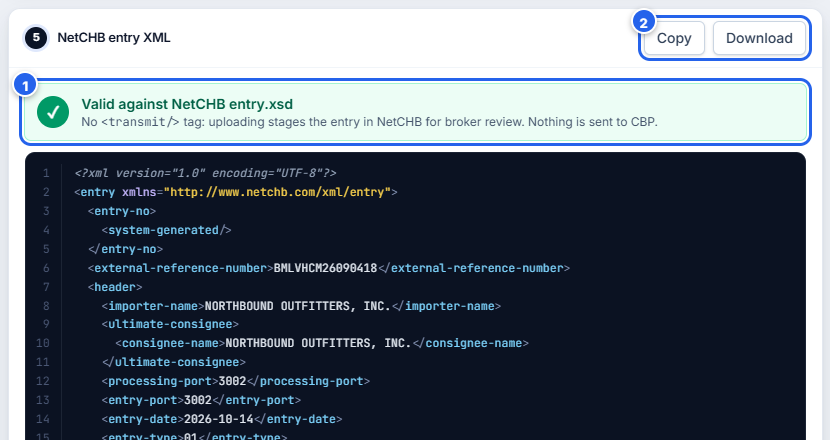

1. Wait for the green **Valid against NetCHB entry.xsd** banner.
2. Click **Copy** to put the XML on your clipboard, or **Download** to save it as a file (named after the bill of lading).

Then upload the file to NetCHB through your account's XML upload or NetCHB's entry upload web service. ⚠️ The entry arrives **staged, not transmitted**. Review it in NetCHB, then transmit it from there.

### 5.9 Export the compliance audit trail

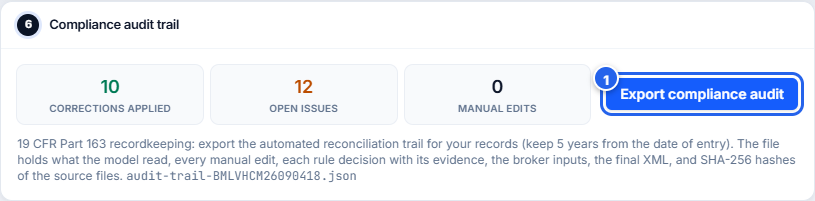

1. Click **Export compliance audit** to download `audit-trail-<entry>.json`.

The file records:
- what the AI model read from each document;
- every manual edit, with the value before and after;
- each correction the rules made, with its evidence, kept separate from the issues still open;
- your broker inputs;
- the final XML and its validation result;
- SHA-256 fingerprints of the source files, the XML and the schema, which tie the record to the exact documents used.

The three counters above the button summarise **Corrections applied**, **Open issues** and **Manual edits**. Keep the file with the shipment's commercial documents: entry records must be kept for five years from the date of entry (19 CFR 163.4). The audit file supports that record; it does not replace it.

### 5.10 Use the website on a phone

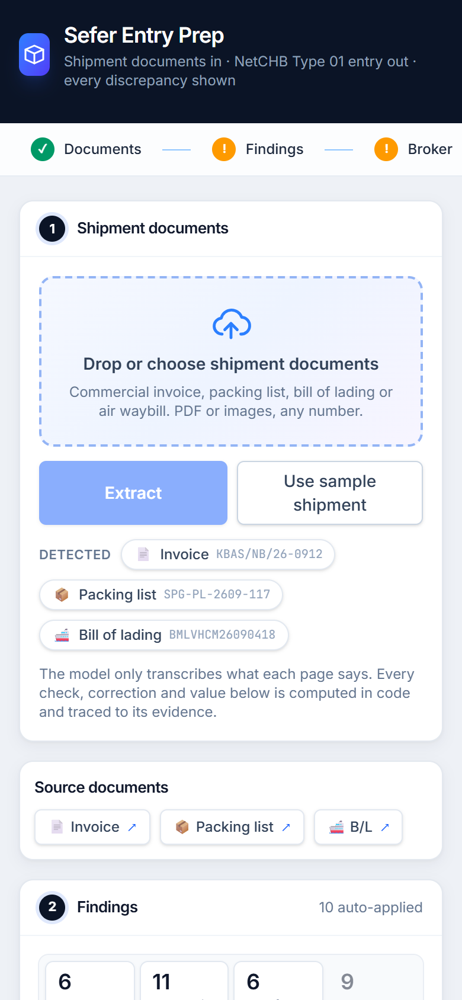

On a phone, the sections stack vertically. Instead of a document pane, **Source documents** shows a button for each document; tap one to open it in your phone's viewer. Uploading and reviewing work the same as on a desktop.

---

## 6. Reference

### 6.1 Badges and colours

| Badge | Meaning |
|---|---|
| 🔴 **error** | Must be resolved before filing (a wrong value, a missing required item, or two documents that disagree). |
| 🟠 **warning** | Needs a broker's judgement or confirmation. |
| 🔵 **info** | Explains something the website did or assumed. |
| 🟣 **xml** | How a value was fitted into NetCHB's format (for example, removing `/` from an invoice number). |
| 🟢 **auto-applied** | The website changed a value on the entry; the finding shows both values. |
| **FOC** / **assist** | Free-of-charge line / line whose value includes a buyer-supplied assist. |

### 6.2 Common findings and what to do

| Finding | What it means | What to do |
|---|---|---|
| Printed amount does not equal quantity × unit price | A line's arithmetic is wrong. If the invoice subtotal proves which figure is right, the website uses it. | Ask the seller for a corrected invoice. |
| Invoice says X, packing list says Y | The two documents disagree on a style's quantity, even if their totals match. | Confirm the shipped count with the shipper. |
| Buyer-supplied material is an assist | The price excludes materials the buyer provided; their value is added to the dutiable value. | Confirm the assist value with the importer. |
| Line is made in a different country | A line's own remarks give a different origin from the rest of the shipment. | Confirm origin; check the carton marking. |
| Importer of record assumed to be the buyer | The bill of lading consignee looks like a warehouse or forwarder. | Confirm the importer and enter its IRS/EIN number. |
| Document amended | A value was struck through or handwritten. A container number is checked with its check digit. | Confirm with the carrier's arrival notice. |
| Only a 6-digit HS code is given | CBP needs 10 digits. | Classify the line and enter the HTS number. |
| Bill or invoice number differs between documents | The same number was read two ways, or the documents don't match. | Check both documents and correct the misread value. |
| Field was hard to read | The AI model marked a value as uncertain (smudged, stamped over). | Check it against the document. |
| Possible FDA / FCC / EPA… requirements | The goods description suggests a partner government agency may regulate them. This is a hint, not a determination. | Check the PGA flags on the 10-digit HTS number. |

### 6.3 Information only the broker can supply

Shipping documents never carry the importer's IRS/EIN number, the bond type and surety, the filer code and entry number, the related-party declaration, or the 10-digit HTS classification. The website asks for these under **Broker inputs** and **Entry lines**.

### 6.4 Defaults the website assumes

Each default is stated as a finding and can be changed.

| Item | Default |
|---|---|
| Entry type | 01 (consumption) |
| Entry date | The estimated arrival date |
| Port of entry | Derived from the port of discharge (for example Tacoma → 3002) |
| Importer of record | The buyer on the invoice |
| State of destination | The delivery address's state |
| Entry number | Generated by NetCHB, unless you give a filer code and entry number |

---

## 7. Troubleshooting

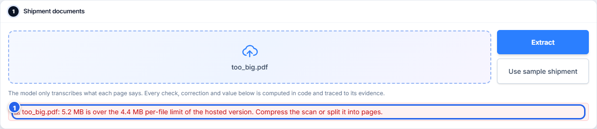

| What you see | Why | What to do |
|---|---|---|
| **… is over the 4.4 MB per-file limit** | The hosting platform refuses larger uploads. | Compress the scan or split it into pages. |
| **Unsupported file type** | Only PDF and image files can be read. | Save the document as PDF, PNG or JPG. |
| **The Gemini API key's daily quota is used up…** | The AI service's daily allowance is used up. | Try again after the reset time shown. **Use sample shipment** still works. |
| **Gemini is overloaded right now…** | The AI service is busy. | Wait a few minutes and try again. |
| **Reading it took longer than the server allows** | A very large or complex scan. | Try again, or upload a smaller scan. |
| **Access code** box appears | Your administrator requires a code for reading documents. | Enter the code you were given (see below). |
| Red **✗ XSD error** in the XML panel | Required information is missing. | Follow **What to fix…** (step 5.7). |
| A section shows **Unable to render…** | An unusual value broke that one section; the rest still works. | Check **Extracted documents** for odd values, then click **Try again**. |
| The document pane is blank | Some browsers, especially on phones, can't show PDFs inside a page. | Use **Open ↗** to view it in a new tab. |

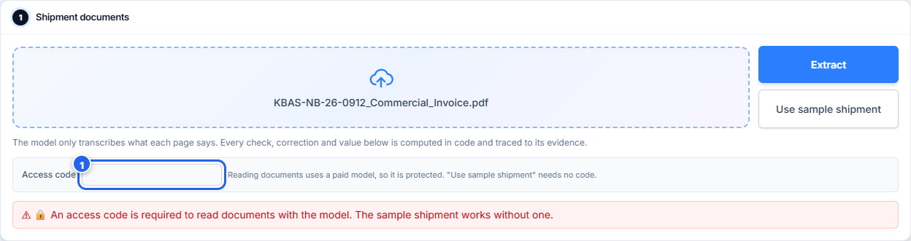

**Access code.** If the website asks for one, type it in the **Access code** box and click **Extract** again. Reading documents uses a paid AI service, so administrators can protect it. The sample shipment never needs a code.

---

## 8. Frequently asked questions

**Does the website send anything to U.S. Customs?**
No. It produces a file. Uploading that file to NetCHB stages the entry; a broker must transmit it from NetCHB.

**Can I trust the values it changes?**
It changes a value only when the documents prove the correction, for example when only the recomputed amount adds up to the invoice subtotal. Each change is shown as **auto-applied** with both values, and recorded in the audit trail. Review them before filing.

**Why doesn't it fill in the 10-digit HTS number?**
Classification is a broker's legal judgement. Padding a 6-digit code would look like a real classification and could misstate duty.

**What if two documents disagree?**
The website shows both values and the evidence for each, and never picks one silently. You decide, using the side-by-side viewer.

**Does it work for shipments other than the sample?**
Yes. The rules are based on what documents mean, not on one invoice's layout. Different currencies, terms of sale, air waybills, multiple invoices, missing documents and missing data are all handled. Anything it can't settle becomes a finding.

**Are my documents stored? Who sees them?**
The website does not keep them: they are read when you click **Extract**, and the results live only in your browser tab. Download the XML and the audit trail before you close the page. To be read, each document **is sent to Google's Gemini AI service**. On Gemini's free tier, Google's terms allow it to use the content it receives to improve its products. For client documents, your administrator should use a paid Gemini account, whose terms exclude this. The **Use sample shipment** button sends nothing to Google.

---

## 9. Glossary

| Term | Meaning |
|---|---|
| **Assist** | Materials, tooling or design the buyer supplied free or cheaply to make the goods. Their value is added to the customs value. |
| **CIF / FOB** | Terms of sale. A CIF price includes international freight and insurance, which are removed for customs value. An FOB price does not include them. |
| **Entry (Type 01)** | A consumption entry: the filing that declares imported goods to U.S. Customs. |
| **FOC / NCV** | Free of charge / no commercial value. Such goods must still be declared at a value. |
| **House / master bill** | A forwarder's (NVOCC) bill of lading travels under the ocean carrier's master bill. Each has its own carrier code. |
| **HTS (HTSUS)** | The 10-digit U.S. tariff classification number. Invoices often show only the first 6 digits (HS). |
| **Importer of record (IOR)** | The party legally responsible for the entry and its duties. Often the buyer, not necessarily the bill of lading consignee. |
| **MID** | Manufacturer identification code, built from the manufacturer's name, address and city (not from a trading company's). |
| **NetCHB** | Customs brokerage software (Descartes NetCHB) used to file entries with U.S. Customs. |
| **PGA** | Partner Government Agency: an agency such as FDA, FCC or EPA that regulates some goods alongside Customs. |
| **SCAC** | The four-letter code identifying a carrier or forwarder. |
| **XSD** | The schema that defines a valid NetCHB entry file. The website checks every file against it. |

---

## 10. Limits and further reading

**Known limits**

- 10-digit HTS classification, trade remedies (Section 301, antidumping/countervailing duties) and partner-agency filings are left to the broker.
- With several invoices in different currencies or terms of sale, valuation uses the first invoice's; a warning says so.
- The master bill number appears only on the bill of lading, so a misread can't be caught by comparing documents. Check it against the document.
- On the free AI tier, the number of documents that can be read per day is limited.

**Further reading**

- [README](../README.md): running and deploying the website, and how it works.
- [WRITEUP](../WRITEUP.md): the design decisions and judgement calls.
- [schemas/SOURCE.md](../schemas/SOURCE.md): where NetCHB's format comes from.
- [ADDING_A_RULE.md](ADDING_A_RULE.md): for developers adding a new check.
